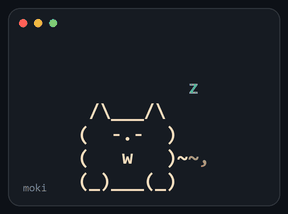

<h1 align="center">Hey, I'm Mohith.</h1>

  I build tools that let people set rules for AI agents and check what they did.

  <a href="https://smohith.vercel.app/">Portfolio</a> &middot;
  <a href="https://www.linkedin.com/in/smohiths/">LinkedIn</a> &middot;
  <a href="https://github.com/MokiMeow?tab=repositories">Repositories</a>

  

Agents propose. Code checks. People decide. I like building systems that make each of those steps visible.

## Selected work

- **[Take Two](https://github.com/MokiMeow/take-two)** keeps a film crew on one schedule when the shoot changes. Agents suggest a new plan and the crew approves it after the app checks which scenes are affected. [Watch the two-minute film](https://github.com/MokiMeow/take-two/releases/tag/v1.0)
- **[AxiomGate](https://github.com/MokiMeow/Axiomgate)** sets action limits for Codex and requires verifiable evidence before it can mark a task complete. [Get it on npm](https://www.npmjs.com/package/axiomgate)
- **[PatchPilot](https://github.com/MokiMeow/PatchPilot)** scans dependencies for known vulnerabilities, flags packages your code imports, and keeps remediation behind human approval. [Explore the dashboard](https://trypatchpilot.vercel.app/)

## Open source

I built [Promise Keeper](https://github.com/MokiMeow/promise-keeper) so Hermes users can turn instructions from a chat into enforceable tool rules. It’s in the [Hermes plugin catalog](https://github.com/NousResearch/hermes-agent/pull/151929). I’ve also landed fixes in [ONNX Runtime](https://github.com/microsoft/onnxruntime/pull/33277), [Highway](https://github.com/google/highway/pull/3514), and [React Email](https://github.com/resend/react-email/pull/3795).

## Side projects

I wrote a [kernel that boots into its own shell](https://github.com/MokiMeow/nutshell) and a [JIT compiler that emits x86-64 machine code](https://github.com/MokiMeow/nutjit). I also built a [3D workroom you can explore](https://3dinsightportfolio.vercel.app/).

  <picture>
    <source media="(prefers-color-scheme: dark)" srcset="./assets/moki-buddy.gif">
    <source media="(prefers-color-scheme: light)" srcset="./assets/moki-buddy-light.gif">
    
  </picture>

